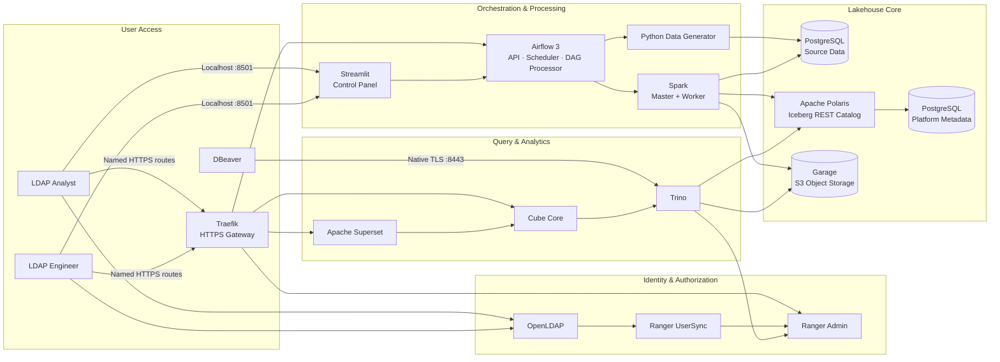
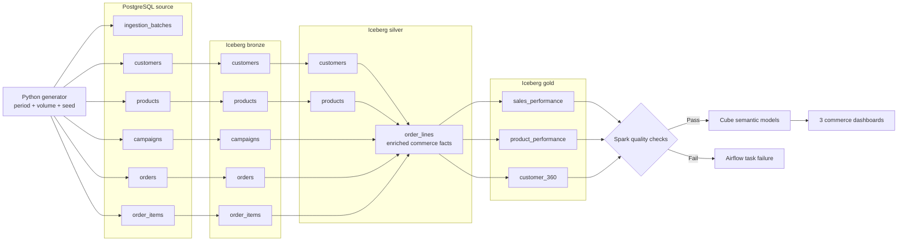

# On-Premises Data Lakehouse

An enterprise-shaped, single-host lakehouse that demonstrates how identity,
authorization, orchestration, open table formats, semantic modeling, and
business intelligence fit together without a public-cloud dependency.

The platform starts with one command, generates its own demo data, processes
every transformation in Spark, stores Iceberg tables in Garage, and exposes
governed analytics through Trino, Cube, and Superset.

## Architecture



All data transformations run in Spark. Trino remains query-only, Polaris owns
Iceberg catalog metadata, Garage stores table objects, and Ranger governs the
supported human query path.

## Data Journey



Batch identifiers make retries idempotent. The first automatic run creates two
years of realistic commerce history; later runs append non-overlapping 30-day
periods. Spark validates all three curated gold models before Cube exposes
them.

## Quick Start

### Requirements

- Linux `amd64`
- Docker Engine with Compose v2
- 16 GiB RAM minimum; 24 GiB recommended
- Approximately 30 GiB free disk for source builds, images, and data
- `openssl`, `keytool`, `curl`, `jq`, and Python 3

Add the local application names:

```text
127.0.0.1 airflow.lakehouse.local ranger.lakehouse.local
127.0.0.1 superset.lakehouse.local cube.lakehouse.local
```

Start the complete platform:

```bash
./lakehouse.sh up
```

Trust `platform/config/pki/ca.crt` in the browser or operating-system trust
store. LDAP usernames and passwords are stored in the ignored `.env` file.

| Service | Endpoint |
| --- | --- |
| Control panel | `http://127.0.0.1:8501` |
| Airflow | `http://127.0.0.1:8080` or `https://airflow.lakehouse.local` |
| Spark | `http://127.0.0.1:8081` |
| Ranger | `https://ranger.lakehouse.local` |
| Superset | `http://127.0.0.1:8088` or `https://superset.lakehouse.local` |
| Cube | `https://cube.lakehouse.local` |
| Trino | `https://127.0.0.1:8443` |
| PostgreSQL source | `localhost:5432`, database `retail` |
| OpenLDAP | `ldaps://localhost:636` |

### Access Model

The stack deliberately uses two access patterns:

| Pattern | Services | Purpose |
| --- | --- | --- |
| Traefik HTTPS | Airflow, Ranger, Superset, Cube | Friendly browser hostnames, shared TLS termination, and Docker-label discovery |
| Direct localhost | Control panel, Airflow, Spark, Superset, Trino | Immediate host-only operations and JDBC connectivity without publishing services to the LAN |

Traefik routes are declared on each participating service with
`traefik.enable`, router, TLS, and load-balancer port labels. Airflow appears in
both patterns: the HTTPS hostname is the secure browser route, while port
`8080` is a localhost-only convenience endpoint. Spark uses its master as a
reverse proxy for worker and live application pages. Trino retains native TLS
on `8443` because JDBC clients such as DBeaver connect directly to the
coordinator.

## Demo Personas

| Identity | Platform role | Data access |
| --- | --- | --- |
| `LDAP_ANALYST_USERNAME` (`alice.analyst` by default) | Airflow Viewer, Superset Gamma | Read-only curated data with customer email masking |
| `LDAP_ENGINEER_USERNAME` (`bob.engineer` by default) | Airflow Op, Superset Alpha | Read/write access across the lakehouse |
| `svc_cube` | Non-human LDAP identity | Least-privilege access to required gold tables |

Human identities live in LDAP. Application databases may cache identity
metadata, but they do not define separate human passwords. Cross-user
impersonation is intentionally disabled.

## Run the Demo

```bash
./lakehouse.sh pipeline
ROWS=5000 SEED=100 ./lakehouse.sh pipeline
```

The DAG generates correlated commerce records, loads bronze tables, produces
silver and gold models, and runs Spark quality checks. Open Airflow to follow
the run and Superset to explore Executive Commerce, Product & Sales, and
Customer & Operations.

The control panel offers the same trigger through a browser and displays recent
DAG runs and task status without a user-facing login. Because it is bound only
to `127.0.0.1`, it operates in local convenience mode and uses the configured
engineer identity internally when calling Airflow.

## Connect DBeaver

Create a Trino connection with:

```text
URL:      jdbc:trino://127.0.0.1:8443/lakehouse/gold?SSL=true
User:     value of LDAP_ANALYST_USERNAME or LDAP_ENGINEER_USERNAME in .env
Password: corresponding LDAP password in .env
```

For a copy-ready TLS truststore example, including the `keytool` command,
password, and exact DBeaver driver properties, see
[`docs/operations.md`](docs/operations.md#dbeaver).

Queries authenticate against LDAP and are authorized by Ranger. For example,
The configured analyst receives the analyst policy and column masking, while
the configured engineer receives engineering access. Both roles can read the
`system.jdbc` metadata required by DBeaver without receiving additional access
to lakehouse tables.

## Repository Map

```text
platform/         Container images and service configuration
orchestration/    Airflow DAG definitions
data-pipeline/    Python generator and Spark transformations
analytics/        Cube models and Superset bootstrap code
control-panel/    Streamlit pipeline operations UI
operations/       Lifecycle and operational automation
tests/            Static and integration smoke tests
docs/             Architecture, security, operations, and decisions
```

Each domain includes its own README:

- [Platform](platform/README.md)
- [Orchestration](orchestration/README.md)
- [Data pipeline](data-pipeline/README.md)
- [Analytics](analytics/README.md)
- [Control panel](control-panel/README.md)
- [Operations](operations/README.md)
- [Documentation index](docs/README.md)

## Operations

```bash
./lakehouse.sh ps
./lakehouse.sh logs
./lakehouse.sh test
./lakehouse.sh backup
./lakehouse.sh down
CONFIRM_RESET=yes ./lakehouse.sh reset
```

## Deep Dives

- [Architecture](docs/architecture.md)
- [Security model](docs/security.md)
- [Operations guide](docs/operations.md)
- [Architecture decisions](docs/decisions.md)
- [Container image provenance](docs/images.md)
