# On-Premises Data Lakehouse

**A fully self-hosted data lakehouse you can start with one command: Iceberg tables, single sign-on, governed access, and notebooks with Trino and Spark built in. It runs on one machine today and is shaped to grow onto several.**

[](LICENSE)
[](https://github.com/ShollyWolly/OnPrem-Data-Lakehouse/actions/workflows/validate.yml)


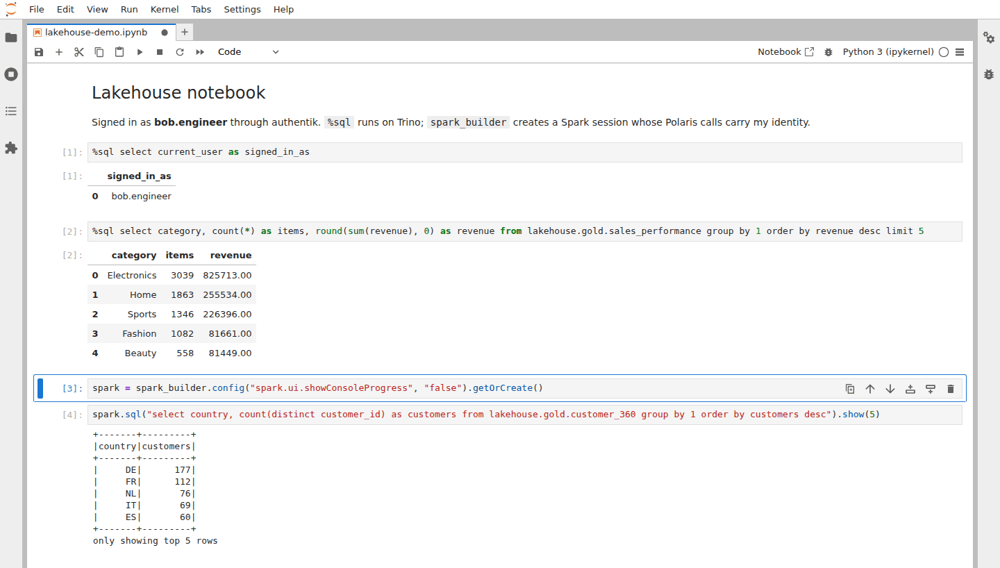

*A JupyterLab notebook on the running stack. `%sql` runs on Trino and `spark_builder` is a pre-wired Spark session; both know who is signed in. Every screenshot on this page comes from the stack running locally on generated demo data.*

## What it is

Everything you would expect from a modern lakehouse, self-hosted and wired together so that it works out of the box:

- **Open table format.** Apache Iceberg tables in a medallion layout (bronze, silver, gold), stored on Garage (S3-compatible) and cataloged by Apache Polaris.
- **One identity everywhere.** Users live in OpenLDAP and sign in through authentik (OIDC) to JupyterHub, Airflow, Superset, and the Trino UI; Trino also accepts the same token from notebooks, and DBeaver can use an LDAP password. Machines get their own system identities instead of shared passwords.
- **Governed access.** Ranger authorizes Trino with column masking, and Polaris authorizes Spark per identity at the catalog.
- **Pipelines and analytics.** Airflow runs a deterministic retail pipeline on Spark. Cube and Superset serve three dashboards on the curated gold tables.
- **Notebooks that are already connected.** `%sql` and a pre-configured `spark_builder` are available in every kernel, with no connection settings to copy around.
- **Tested.** Static contracts and a live-stack integration suite that covers service health, LDAP, the SSO redirect, machine tokens, and Polaris refusing the root credential and invalid tokens.

It is a lab-scale system you own end to end, not a managed product. The [limitations](#limitations) are stated plainly below.

## See it working

### Same notebook, two identities

Alice (analyst) and Bob (engineer) run the identical notebook. The checks name the system that makes each decision.

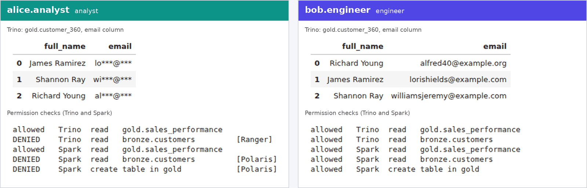

| | `alice.analyst` | `bob.engineer` |
| --- | --- | --- |
| Customer emails in Trino | masked (`lo***@***`) | in clear |
| Read `gold` tables | yes | yes |
| Read `bronze` in Trino | denied by Ranger | yes |
| Read `bronze` in Spark | denied by Polaris | yes |
| Create a table in Spark | denied by Polaris | yes |

### The platform

| | |
| --- | --- |
| 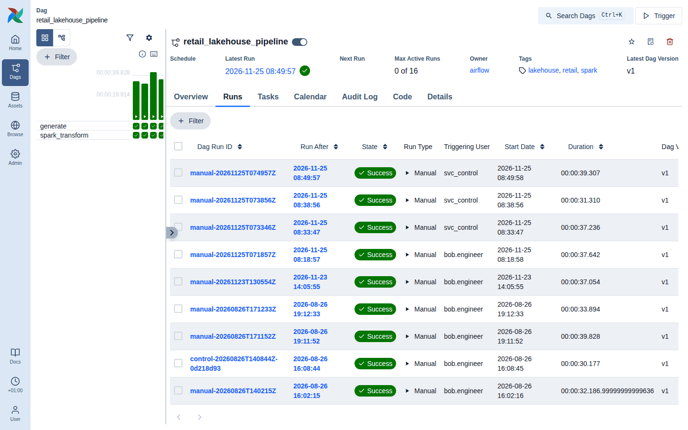 | 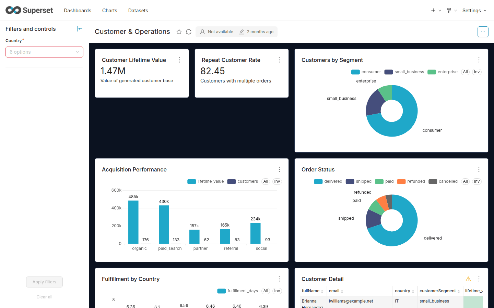 |
| **Airflow.** The pipeline runs triggered by an engineer and by the `svc_control` system user. | **Superset.** A dashboard served through the Cube semantic layer. |
| 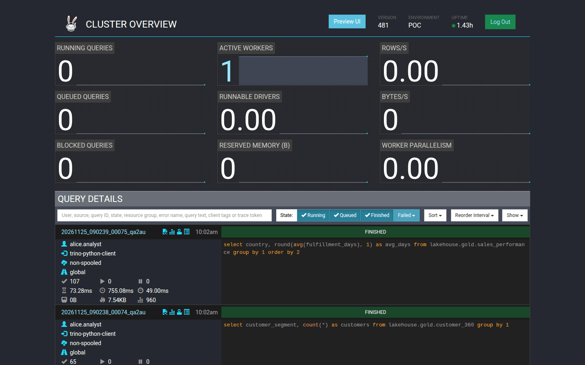 | 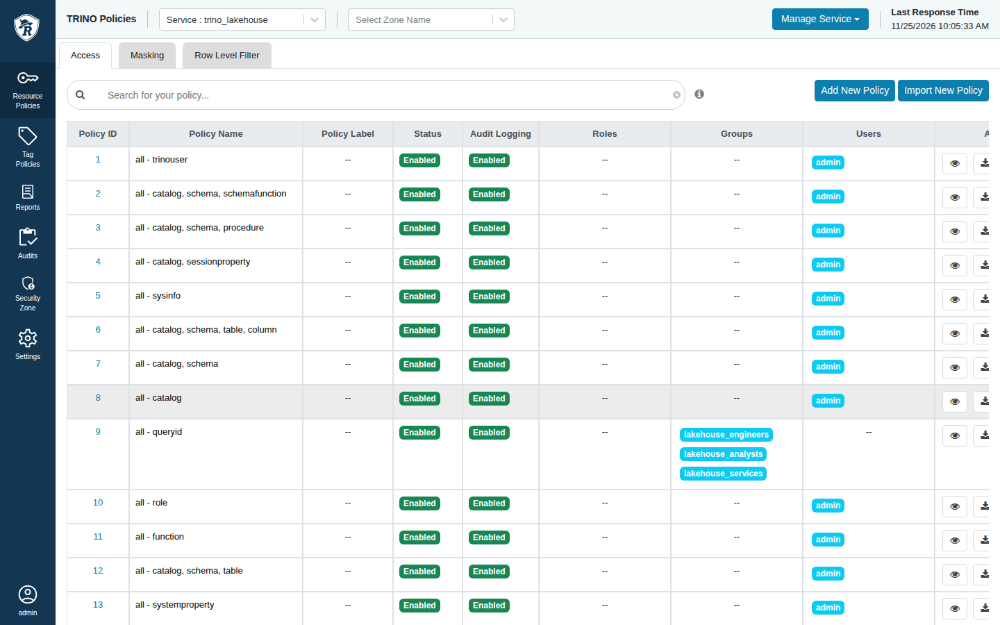 |
| **Trino.** Finished queries attributed to the signed-in user. | **Ranger.** The policies that govern Trino. |
| 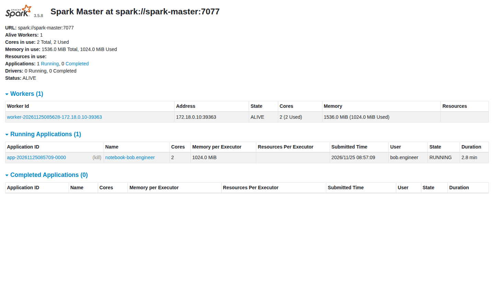 | 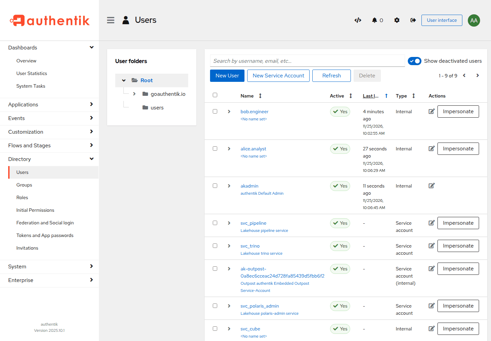 |
| **Spark.** A notebook session running on the cluster as `bob.engineer`. | **authentik.** People and the machine identities. |
| 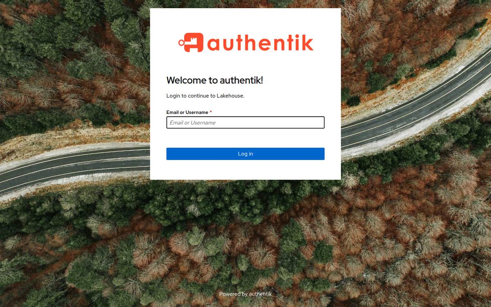 | 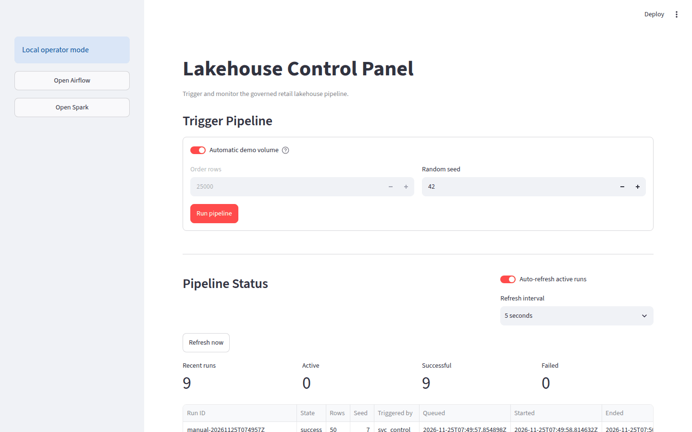 |
| **Single sign-on.** One login page in front of every application. | **Control panel.** A small local UI to trigger and watch pipeline runs. |

## Architecture

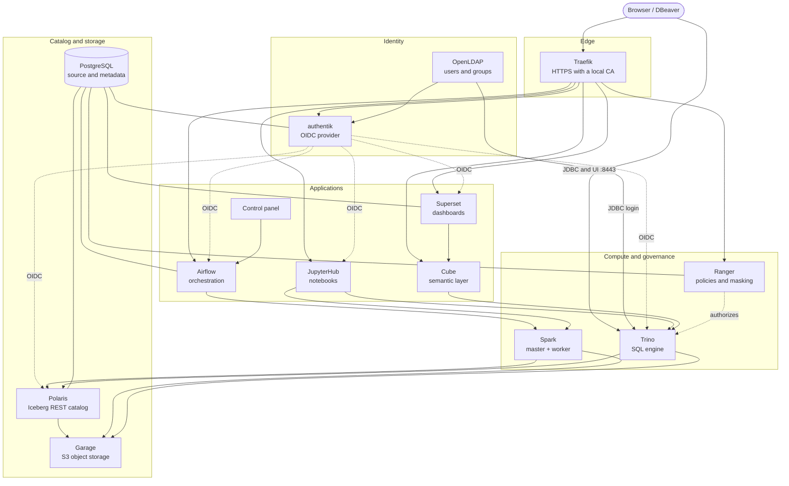

Services run as single-replica containers on one Docker network, behind Traefik for browser routes. Detailed topology, ports, and per-service responsibilities are in [architecture](docs/architecture.md).

### Data journey

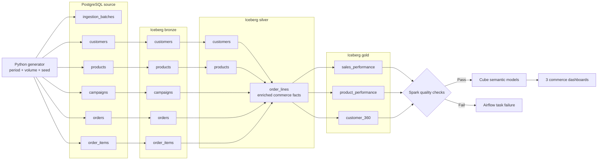

Batch identifiers make retries idempotent. The first automatic run creates two years of commerce history; later runs append non-overlapping 30-day periods. Spark validates all three gold models before Cube exposes them.

## Identity and access

Humans sign in once through authentik, which reads users and groups from OpenLDAP. Applications receive a token that carries the username and the groups.

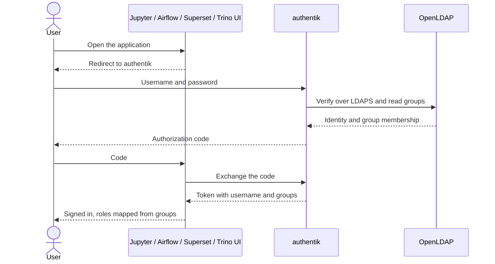

In a notebook the same token reaches both engines:

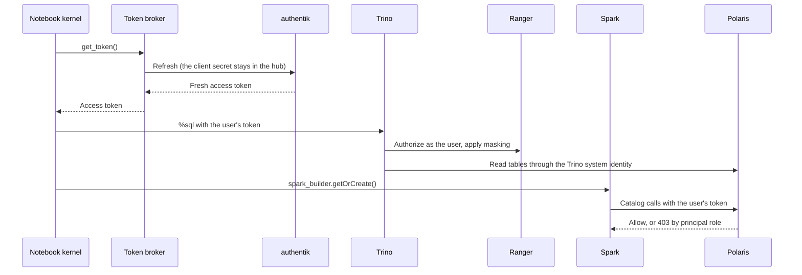

Machines never share a human account. Airflow's Spark job, Trino's catalog connection, and the bootstrap each authenticate with their own authentik service account (`svc_pipeline`, `svc_trino`, `svc_polaris_admin`), and the control panel uses a local Airflow system user (`svc_control`). Polaris runs in external-authentication mode, so it accepts only authentik tokens and refuses any shared credential.

### Who enforces what

| Entry point | Identity the platform sees | Enforced by |
| --- | --- | --- |
| Trino (`%sql`, DBeaver, UI) | the signed-in user | **Ranger**: table and column policies, email masking |
| Spark in a notebook | the signed-in user, carried to Polaris | **Polaris**: principal roles at the catalog level |
| Airflow pipeline | `svc_pipeline` | Polaris role `pipeline` (write) |
| Trino to the catalog | `svc_trino` | Polaris role `trino` (read-only) |
| Superset and Cube | `svc_cube` | Ranger, limited to the gold tables |
| Garage (object files) | shared storage keys | not enforced, see [limitations](#limitations) |

## Notebooks

Every kernel starts with the platform already connected.

```python
# Trino, as you
%sql select category, round(sum(revenue)) as revenue from lakehouse.gold.sales_performance group by 1 order by 2 desc

# Spark, as you
spark = spark_builder.getOrCreate()
spark.sql("select * from lakehouse.gold.customer_360 limit 5").show()
```

`%sql` returns a pandas DataFrame. `spark_builder` accepts `appName` and `config` before `getOrCreate()`. Tokens refresh automatically through a small service in the hub, so the OIDC client secret never reaches a kernel.

## Limitations

This is a self-hosted lab system and it is honest about where it stops.

- **Spark does not carry the OIDC context into storage.** Spark reads data files from Garage with shared storage keys, so a user's identity does not travel past the catalog. Access is enforced at the catalog: Polaris decides, per identity, which tables a notebook may list, read, or create. Garage has no per-user enforcement, and anyone holding the storage keys could read files directly. The design assumes people reach data through the catalog.
- **Masking is a Trino feature.** Ranger's column masks apply to Trino only. A Spark session reads unmasked columns in any table its Polaris role allows.
- **Some components stay on LDAP or have no login.** Ranger Admin and its user sync use LDAP, Cube reaches Trino with one system account, and the Spark and control-panel UIs are bound to the loopback interface without a login.
- **Demo-sized.** One replica per service and a two-core Spark worker, so one notebook Spark session at a time uses the whole cluster. A notebook Spark session keeps the token it started with (eight hours), then needs recreating.
- **Lab security posture.** A local CA, generated secrets in an ignored `.env`, and plain HTTP on loopback ports. Fine for a lab, not a hardened deployment.

## Scaling to multiple machines

The stack starts on one host, but its pieces are the kind that scale out. The table describes where each one goes next. It is a design direction, not something that has been exercised here.

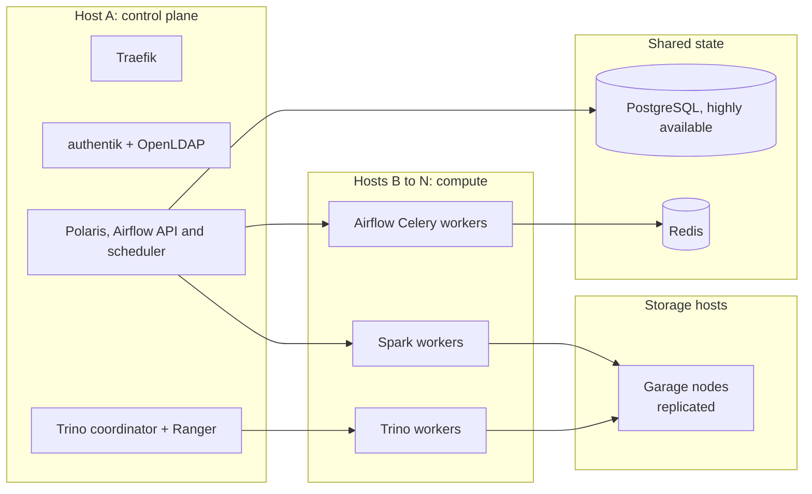

| Component | Path to multiple machines |
| --- | --- |
| Spark | Register more workers from other hosts with the same master |
| Trino | Add worker nodes to the coordinator; internal TLS and the shared secret are already configured |
| Garage | Grow into a multi-node cluster with replication across storage hosts |
| Airflow | Add Celery workers; the Redis broker is already in place |
| Polaris, Airflow API, authentik | Run replicas behind Traefik |
| JupyterHub | Move its state database from SQLite to PostgreSQL before running more than one hub |
| PostgreSQL, Redis | Move to a highly available or managed deployment |
| Orchestration | Move from Compose to Swarm or Kubernetes when one host is no longer enough |

## Quick start

**Requirements:** Linux `amd64`, Docker Engine with Compose v2, 16 GiB RAM minimum (24 GiB recommended), about 30 GiB of free disk, and `openssl`, `keytool`, `curl`, `jq`, and Python 3.

```bash
# 1. add the local hostnames
echo '127.0.0.1 airflow.lakehouse.local ranger.lakehouse.local superset.lakehouse.local cube.lakehouse.local authentik.lakehouse.local jupyter.lakehouse.local' | sudo tee -a /etc/hosts

# 2. build and start everything (the first build compiles Ranger and OpenLDAP from source)
./lakehouse.sh up

# 3. trust platform/config/pki/ca.crt in your browser, then run the pipeline
./lakehouse.sh pipeline
```

Generated passwords live in the ignored `.env` file. Sign in as `alice.analyst` (analyst) or `bob.engineer` (engineer); `akadmin` administers authentik.

| Service | Address |
| --- | --- |
| JupyterHub | https://jupyter.lakehouse.local |
| Airflow | https://airflow.lakehouse.local |
| Superset | https://superset.lakehouse.local |
| Cube | https://cube.lakehouse.local |
| authentik | https://authentik.lakehouse.local |
| Ranger | https://ranger.lakehouse.local |
| Trino | https://127.0.0.1:8443 |
| Control panel | http://127.0.0.1:8501 |
| Spark master | http://127.0.0.1:8081 |

DBeaver, backups, reset, and troubleshooting are in the [operations guide](docs/operations.md).

```bash
./lakehouse.sh ps        # status
./lakehouse.sh logs      # logs
./lakehouse.sh test      # static and integration tests
./lakehouse.sh backup    # PostgreSQL, LDAP, and Garage backups
./lakehouse.sh down      # stop
```

## Tech stack

| Layer | Component | Version |
| --- | --- | --- |
| Table format and catalog | Apache Iceberg, Apache Polaris | 1.10.0, 1.6.0 |
| Object storage | Garage | 2.3.0 |
| Processing | Apache Spark | 3.5.8 |
| SQL engine and governance | Trino, Apache Ranger | 481, 2.8.0 |
| Orchestration | Apache Airflow, Redis | 3.3.0, 7.2.15 |
| Identity | OpenLDAP, authentik | 2.6.13, 2025.10.1 |
| Notebooks | JupyterHub, JupyterLab | 5.3.0, 4.4.9 |
| Analytics | Cube, Apache Superset | 1.7.11, 6.1.0 |
| Edge and data | Traefik, PostgreSQL | 3.7.1, 17.10 |
| Operations UI | Streamlit | 1.59.2 |

All versions are pinned in [`compose.yaml`](compose.yaml); nothing uses `:latest`.

## Testing

| Suite | What it checks |
| --- | --- |
| `./tests/static.sh` | Compose config and contract, Python compile checks, unit tests, Ranger policy JSON, image pins (no `:latest`), certificate files, and Markdown links. Runs in CI on every push. |
| `./tests/integration.sh` | A live stack: service health and routing, LDAP binds, the Airflow SSO redirect and `svc_control` token, a Trino gold query as the analyst, and Polaris accepting machine identities while refusing the root credential and invalid tokens |
| `RUN_PIPELINE_TEST=1 ./tests/integration.sh` | The whole pipeline end to end |

## Repository map

```text
platform/         Container images and service configuration
orchestration/    Airflow DAG definitions
data-pipeline/    Python generator and Spark transformations
analytics/        Cube models and Superset bootstrap code
control-panel/    Streamlit pipeline operations UI
operations/       Lifecycle and operational automation
tests/            Static and integration tests
docs/             Architecture, security, and operations
```

Each domain has its own README: [platform](platform/README.md), [orchestration](orchestration/README.md), [data pipeline](data-pipeline/README.md), [analytics](analytics/README.md), [control panel](control-panel/README.md), [operations](operations/README.md). Deeper reading: [architecture](docs/architecture.md), [security model](docs/security.md), [operations guide](docs/operations.md), and the [documentation index](docs/README.md).

## License

Licensed under the [Apache License 2.0](LICENSE). The stack builds on other open-source projects, listed in [NOTICE](NOTICE); each keeps its own license.
