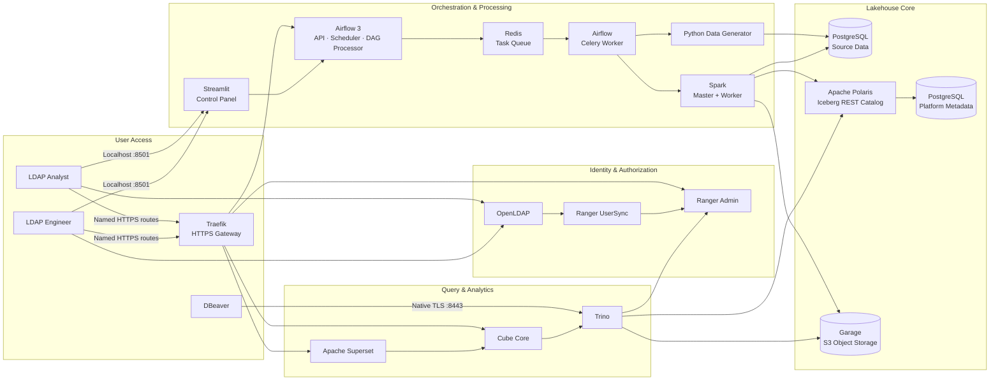
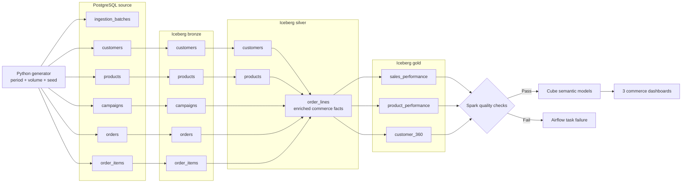

# On-Premises Data Lakehouse

Single-host Docker Compose lakehouse with LDAP identity, Ranger authorization,
Spark processing, Iceberg tables, and governed analytics.

## Architecture



All data transformations run in Spark. Trino remains query-only, Polaris owns
Iceberg catalog metadata, Garage stores table objects, and Ranger governs the
supported human query path.

## Container Responsibilities

Airflow task execution is separated from scheduling:

```text
Airflow Scheduler -> Redis queue -> Airflow Worker -> Spark Master -> Spark Worker
```

Redis is an internal-only, transient Celery broker. It has no host port or web
interface; PostgreSQL remains authoritative for Airflow metadata and completed
task results.

| Container | Responsibility |
| --- | --- |
| `lakehouse-postgres` | Hosts retail source data and the Airflow, Ranger, Polaris, and Superset metadata databases. |
| `lakehouse-redis` | Holds queued Airflow tasks until the Celery worker accepts them. |
| `lakehouse-openldap` | Provides identities for analysts, engineers, and service accounts. |
| `lakehouse-ranger-admin` | Manages Trino authorization and column-masking policies. |
| `lakehouse-ranger-usersync` | Synchronizes LDAP users and groups into Ranger. |
| `lakehouse-garage` | Stores Iceberg table objects through an S3-compatible API. |
| `lakehouse-polaris` | Tracks Iceberg catalogs, schemas, tables, and snapshots. |
| `lakehouse-spark-master` | Coordinates Spark applications and provides the Spark UI. |
| `lakehouse-spark-worker` | Executes bronze, silver, gold, and quality-check transformations. |
| `lakehouse-airflow-api` | Provides the Airflow UI, REST API, authentication, and task execution API. |
| `lakehouse-airflow-scheduler` | Determines which tasks are ready and queues them through Redis. |
| `lakehouse-airflow-dag-processor` | Parses and serializes Airflow DAG definitions. |
| `lakehouse-airflow-worker` | Runs Python tasks and hosts the client-mode driver for submitted Spark applications. |
| `lakehouse-control-panel` | Provides the local Streamlit interface for triggering and monitoring pipelines. |
| `lakehouse-trino` | Executes governed interactive SQL over Iceberg tables. |
| `lakehouse-cube` | Defines semantic measures and dimensions over curated gold data. |
| `lakehouse-superset` | Provides dashboards and queries the lakehouse through Cube. |
| `lakehouse-traefik` | Terminates HTTPS and routes named browser endpoints. |

## Tracked Configuration

The stack does not rely on mutable configuration hidden inside containers.
Airflow, Spark, Redis, PostgreSQL, Polaris, Streamlit, Trino, Traefik, and
Superset consume read-only files from `platform/config`; Cube consumes its
tracked configuration from `analytics/cube`. Secrets and container-specific
connection values remain in the ignored `.env` file.

The [configuration inventory](platform/config/README.md) lists every mounted
file, its container path, and how to update vendor-default snapshots safely.

## Data Journey



Batch identifiers make retries idempotent. The first automatic run creates two
years of realistic commerce history; later runs append non-overlapping 30-day
periods. Spark validates all three curated gold models before Cube exposes
them.

## Start

### Requirements

- Linux `amd64`
- Docker Engine with Compose v2
- 16 GiB RAM minimum; 24 GiB recommended
- Approximately 30 GiB free disk for source builds, images, and data
- `openssl`, `keytool`, `curl`, `jq`, and Python 3

Add the local application names:

```text
127.0.0.1 airflow.lakehouse.local ranger.lakehouse.local
127.0.0.1 superset.lakehouse.local cube.lakehouse.local
```

Start the complete platform:

```bash
./lakehouse.sh up
```

Trust `platform/config/pki/ca.crt` in the browser or operating-system trust
store. LDAP usernames and passwords are stored in the ignored `.env` file.

| Service | Endpoint |
| --- | --- |
| Control panel | `http://127.0.0.1:8501` |
| Airflow | `http://127.0.0.1:8080` or `https://airflow.lakehouse.local` |
| Spark | `http://127.0.0.1:8081` |
| Ranger | `http://127.0.0.1:6080` or `https://ranger.lakehouse.local` |
| Superset | `http://127.0.0.1:8088` or `https://superset.lakehouse.local` |
| Cube | `https://cube.lakehouse.local` |
| Trino | `https://127.0.0.1:8443` |
| PostgreSQL source | `localhost:5432`, database `retail` |
| OpenLDAP | `ldaps://localhost:636` |

### Access

| Pattern | Services | Purpose |
| --- | --- | --- |
| Traefik HTTPS | Airflow, Ranger, Superset, Cube | Friendly browser hostnames, shared TLS termination, and Docker-label discovery |
| Direct localhost | Control panel, Airflow, Ranger, Spark, Superset, Trino | Immediate host-only operations and JDBC connectivity without publishing services to the LAN |

## Identities

| Identity | Platform role | Data access |
| --- | --- | --- |
| `LDAP_ANALYST_USERNAME` (`alice.analyst` by default) | Airflow Viewer, Superset Gamma | Read-only curated data with customer email masking |
| `LDAP_ENGINEER_USERNAME` (`bob.engineer` by default) | Airflow Op, Superset Alpha | Read/write access across the lakehouse |
| `svc_cube` | Non-human LDAP identity | Least-privilege access to required gold tables |

## Pipeline

```bash
./lakehouse.sh pipeline
ROWS=5000 SEED=100 ./lakehouse.sh pipeline
```

## DBeaver

Create a Trino connection with:

```text
URL:      jdbc:trino://127.0.0.1:8443/lakehouse/gold?SSL=true
User:     value of LDAP_ANALYST_USERNAME or LDAP_ENGINEER_USERNAME in .env
Password: corresponding LDAP password in .env
```

Detailed TLS driver settings are in [operations](docs/operations.md#dbeaver).

## Repository Map

```text
platform/         Container images and service configuration
orchestration/    Airflow DAG definitions
data-pipeline/    Python generator and Spark transformations
analytics/        Cube models and Superset bootstrap code
control-panel/    Streamlit pipeline operations UI
operations/       Lifecycle and operational automation
tests/            Static and integration smoke tests
docs/             Architecture, security, and operations
```

Each domain includes its own README:

- [Platform](platform/README.md)
- [Orchestration](orchestration/README.md)
- [Data pipeline](data-pipeline/README.md)
- [Analytics](analytics/README.md)
- [Control panel](control-panel/README.md)
- [Operations](operations/README.md)
- [Documentation index](docs/README.md)

## Operations

```bash
./lakehouse.sh ps
./lakehouse.sh logs
./lakehouse.sh test
./lakehouse.sh backup
./lakehouse.sh down
CONFIRM_RESET=yes ./lakehouse.sh reset
```

## Deep Dives

- [Architecture](docs/architecture.md)
- [Security model](docs/security.md)
- [Operations guide](docs/operations.md)
