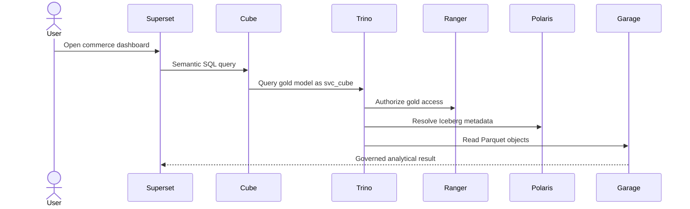

# Analytics

Cube Core provides governed commerce semantics and Superset provides dashboards.

## Semantic Models

| Cube model | Iceberg source | Purpose |
| --- | --- | --- |
| `Sales` | `gold.sales_performance` | Revenue, profit, orders, customers, refunds, channels, geography, and fulfillment |
| `Products` | `gold.product_performance` | Product, category, brand, discount, units, and margin analysis |
| `Customers` | `gold.customer_360` | Lifetime value, repeat behavior, acquisition, and governed customer detail |

Cube connects to Trino as the LDAP service identity `svc_cube`; Ranger
authorizes its gold-table reads. Superset connects only to Cube's
PostgreSQL-compatible SQL interface.

## Dashboards

The idempotent Superset bootstrap creates:

- **Executive Commerce**: revenue, profit, orders, AOV, trends, geography,
  channels, and category contribution.
- **Product & Sales**: category and brand performance, product rankings,
  channel mix, discounts, and margins.
- **Customer & Operations**: customer value, repeat rate, acquisition,
  order outcomes, fulfillment, and masked customer detail.

Twenty-one native Superset charts use a consistent dark executive theme,
responsive grid layouts, and dashboard filters. Restarting Superset reconciles
datasets, metrics, charts, and dashboards without creating duplicates.

