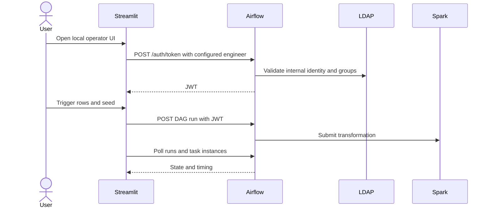

# Control Panel

The Streamlit control panel provides a focused operational UI for the
`retail_lakehouse_pipeline` DAG.

## Access

Endpoint: `http://127.0.0.1:8501`. The panel is loopback-only and has no
user-facing login.

The panel silently obtains an Airflow API token with
`LDAP_ENGINEER_USERNAME` and `LDAP_ENGINEER_PASSWORD` from `.env`. Airflow still
validates that internal identity through LDAP and authorizes it with the
engineer role.

## Features

- Trigger automatic two-year/monthly demo periods or override the order volume.
- Supply a deterministic seed for reproducible business behavior.
- Inspect the latest 20 DAG runs and their parameters.
- Inspect task states and timing for a selected run.
- Refresh manually or poll active runs every 5, 10, or 30 seconds.
- Jump directly to the local Airflow and Spark UIs.

## Data Flow

The application uses the Airflow REST API; the internal password remains in the
container environment.
