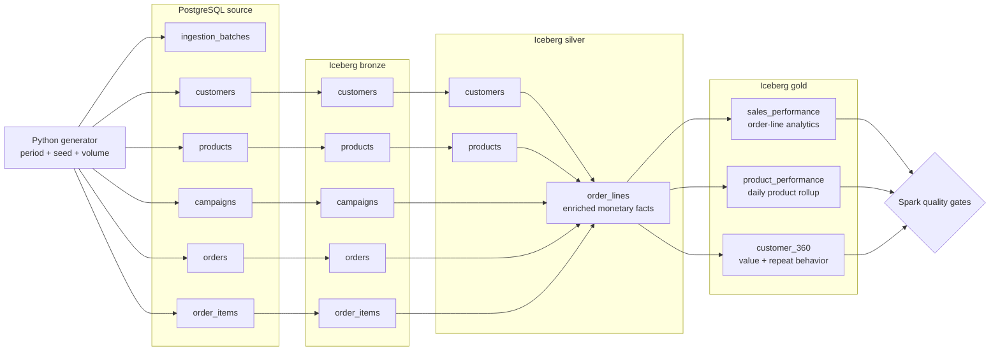

# Data Pipeline

This domain contains the deterministic commerce generator and the Spark
application that builds analytics-ready Iceberg models.

## Synthetic Commerce Domain

The generator creates customers, products, campaigns, orders, and order lines
with correlated business behavior:

- Two years of history and 25,000 orders on the first automatic run.
- A new, non-overlapping 30-day period and 3,000 orders on later automatic runs.
- Seasonal demand, campaign discounts, regional preferences, repeat customers,
  category-specific prices and costs, refunds, and fulfillment timelines.
- Reproducible output for a supplied seed and idempotent retries for a batch ID.

Pass `--rows 0` to select the automatic volume or a positive value to override
it.

## Table Flow

Spark calculates gross sales, discounts, recognized revenue, refunds, cost of
goods, gross profit, margin inputs, and fulfillment duration. It rejects
invalid monetary values, negative timelines, duplicate order lines, and empty
gold output.
