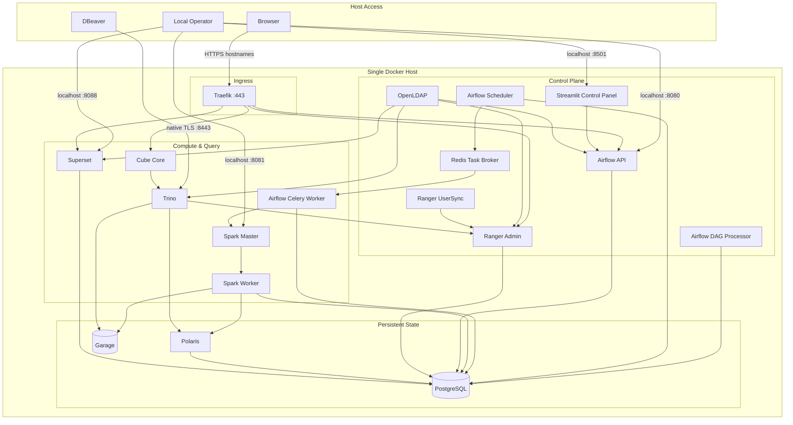

# Architecture

## Design Goals

The platform demonstrates a complete on-premises analytical path with open
components, centralized identity, policy enforcement, reproducible startup, and
clear production boundaries.

The implementation follows four rules:

1. Spark performs all data processing.
2. Trino performs interactive queries but no transformation jobs.
3. Human identities originate in LDAP.
4. Supported human data access passes through Ranger-enforced Trino.

## Deployment Topology

Every service has one replica by design. Spark separates cluster coordination
from execution, while Airflow separates orchestration from queued task work.

The Airflow API and Spark master UI are additionally published on localhost.
Spark master reverse-proxies worker and live application pages so operators use
one Spark endpoint without exposing each process separately.

## Exposure Model

Traefik provides the browser ingress tier for Airflow, Ranger, Cube, and
Superset. These services opt in through Docker labels, and Traefik connects to
their private container ports on the `lakehouse` network.

The control panel and Spark UI are operational tools bound only to loopback, so
they are not registered with Traefik. Trino exposes its own TLS listener on
loopback because JDBC speaks directly to the coordinator. Airflow and Superset
are available through both direct loopback ports and named HTTPS routes.

## Startup Flow

The root CLI starts dependency services, including the Redis task broker, waits
for health, applies Ranger and Polaris configuration from the running Airflow
API container, and then starts workers and presentation services.

No Makefile, one-shot Compose service, or temporary bootstrap container is
required.

## Persistence

Docker volumes retain PostgreSQL, LDAP, Ranger, Garage, Airflow logs, and
Traefik-independent application state. Redis is a transient broker; PostgreSQL
remains authoritative for Airflow and Celery results. Configuration is
bind-mounted read-only from the repository, including the effective Airflow,
Spark, Redis, PostgreSQL, Polaris, and Streamlit settings. Generated secrets,
certificates, and deployment connection values remain outside those tracked
files and are ignored by version control.

## Scaling Path

A production evolution would separate stateful services onto dedicated hosts,
use PostgreSQL and object-storage replication, scale Celery and Trino workers,
introduce remote task logs and a durable broker, externalize secrets, and
deploy multiple ingress instances behind a load balancer.
