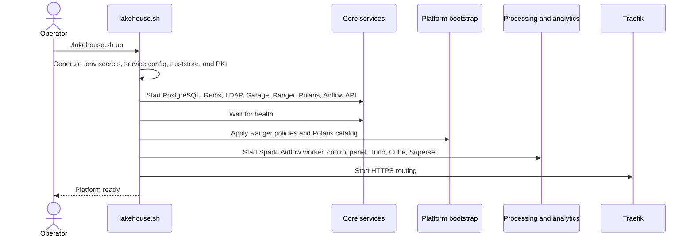

# Operations Guide

## Host Preparation

Install Docker Engine with Compose v2, `openssl`, `keytool`, `curl`, `jq`, and Python 3.
Allocate at least 16 GiB RAM and 30 GiB disk. Ranger and OpenLDAP are built from
source, so the first build is substantially slower than later cached builds.

Add the application hostnames to `/etc/hosts`:

```text
127.0.0.1 airflow.lakehouse.local ranger.lakehouse.local
127.0.0.1 superset.lakehouse.local cube.lakehouse.local
```

## Startup Sequence



## Lifecycle

```bash
./lakehouse.sh up
./lakehouse.sh ps
./lakehouse.sh logs
./lakehouse.sh pipeline
./lakehouse.sh test
./lakehouse.sh backup
./lakehouse.sh down
```

Use `./lakehouse.sh logs SERVICE` to follow a specific component. Re-running
`up` or `bootstrap` is safe.

## Access and Routing

| Interface | Endpoint | Exposure | Authentication |
| --- | --- | --- | --- |
| Control panel | `http://127.0.0.1:8501` | Direct loopback | No user login; internal engineer token |
| Airflow | `http://127.0.0.1:8080` | Direct loopback | LDAP |
| Airflow | `https://airflow.lakehouse.local` | Traefik HTTPS | LDAP |
| Spark master | `http://127.0.0.1:8081` | Direct loopback | None; local operational UI |
| Ranger | `https://ranger.lakehouse.local` | Traefik HTTPS | LDAP-synchronized users |
| Superset | `http://127.0.0.1:8088` | Direct loopback | LDAP |
| Superset | `https://superset.lakehouse.local` | Traefik HTTPS | LDAP |
| Cube | `https://cube.lakehouse.local` | Traefik HTTPS | API authentication |
| Trino | `https://127.0.0.1:8443` | Native TLS over loopback | LDAP plus Ranger |
| PostgreSQL | `127.0.0.1:5432` | Direct loopback | Generated database roles |
| OpenLDAP | `ldaps://127.0.0.1:636` | Direct loopback | LDAP bind |

Traefik discovers only explicitly labeled containers because
`exposedByDefault` is disabled. Spark and the control panel intentionally have
no Traefik labels: they use localhost-only ports. Trino also remains outside
Traefik so JDBC clients reach its native TLS listener directly.

Airflow intentionally supports both access modes. Existing scripts and secure
browser access use the Traefik hostname; direct port `8080` makes the UI
immediately available on the Docker host.

## DBeaver

`./lakehouse.sh init` creates a PKCS12 truststore containing the project CA at
`platform/config/trino/dbeaver-trino-truststore.p12`.

Then create a **Trino** connection using this example:

```text
Host:       127.0.0.1
Port:       8443
Catalog:    lakehouse
Schema:     gold
User:       value of LDAP_ANALYST_USERNAME in .env
Password:   value of LDAP_ANALYST_PASSWORD in .env
JDBC URL:   jdbc:trino://127.0.0.1:8443/lakehouse/gold?SSL=true
```

Under **Driver properties**, set:

```text
SSL                     true
SSLVerification         FULL
SSLTrustStorePath       /absolute/path/to/OnPrem-Data-Lakehouse/platform/config/trino/dbeaver-trino-truststore.p12
SSLTrustStorePassword   changeit
SSLTrustStoreType       PKCS12
```

Replace `SSLTrustStorePath` with the absolute path on your machine. The
truststore password is `changeit`; it protects this local public-certificate
store and is not an LDAP or service password.

After connecting, verify both data and DBeaver metadata access:

```sql
SELECT count(*) FROM lakehouse.gold.customer_360;
SELECT table_cat, table_schem, table_name
FROM system.jdbc.tables
ORDER BY table_cat, table_schem, table_name;
```

The Trino certificate covers `127.0.0.1`. Do not substitute `localhost` unless
the certificate generation configuration is changed accordingly.

Ranger grants both demo groups read-only access to Trino's `system.jdbc`
metadata schema because DBeaver queries it while opening and browsing a
connection. Actual lakehouse table access continues to use the analyst and
engineer policies. If DBeaver previously reported **Access Denied**, use
**Database → Invalidate/Reconnect** after applying the current Ranger policies;
the client may otherwise retain metadata from the failed connection.

## Certificates and Credentials

- Local CA: `platform/config/pki/ca.crt`
- LDAP identities and service secrets: `.env`
- DBeaver truststore: `platform/config/trino/dbeaver-trino-truststore.p12`
- Generated Garage configuration: `platform/config/garage/garage.generated.toml`

Private keys and generated service files are ignored by version control.

## Backup and Reset

`./lakehouse.sh backup` writes timestamped PostgreSQL, LDAP, and Garage backups
under `operations/backups`.

Reset requires explicit confirmation:

```bash
CONFIRM_RESET=yes ./lakehouse.sh reset
```

Reset removes persistent Docker volumes and the rendered Garage configuration.
It retains `.env`, the local PKI, the DBeaver truststore, and backups.

## Troubleshooting

| Symptom | Action |
| --- | --- |
| Docker daemon unavailable | Start Docker and verify `docker info` |
| Browser certificate warning | Trust `platform/config/pki/ca.crt` |
| DBeaver rejects the Trino certificate | Import the local CA into DBeaver's certificate trust store and connect to `127.0.0.1` |
| Control panel cannot load runs | Verify the configured engineer identity in `.env` and check Airflow health |
| Local hostname does not resolve | Recheck `/etc/hosts` |
| First startup is slow | Follow Ranger build and service logs |
| Service remains unhealthy | Run `./lakehouse.sh ps` and `./lakehouse.sh logs SERVICE` |
| Docker Desktop VM exits during a pipeline | Increase the VM memory allocation to at least 16 GiB |

The complete stack is intentionally resource intensive; it demonstrates
integration breadth rather than laptop-scale minimalism.
