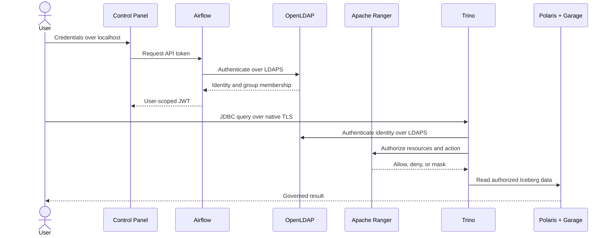

# Security Model

## Identity and Authorization Flow

## Identity

OpenLDAP is authoritative for human users and group membership. Airflow,
Superset, Ranger, and Trino authenticate against LDAP. Application metadata
databases may cache user records but do not define independent human passwords.

The localhost-only control panel obtains an Airflow token with the configured
engineer LDAP identity and keeps only the JWT in Streamlit session state.

Non-human PostgreSQL roles, Garage access keys, Polaris credentials, and the
`svc_cube` LDAP account are service identities generated into `.env`.

## Policy Model

| Identity | Ranger intent |
| --- | --- |
| `LDAP_ANALYST_USERNAME` / `lakehouse_analysts` | Read curated gold tables with customer email masking |
| `LDAP_ENGINEER_USERNAME` / `lakehouse_engineers` | Read and write lakehouse data |
| `svc_cube` | Read only the gold resources required by Cube |

Ranger UserSync imports LDAP users and groups. Trino's Ranger plugin enforces
catalog, schema, table, column, masking, and query-execution policies.
One-to-one user mappings are used; cross-user impersonation is disabled.
The two managed human usernames and passwords come from `.env`; OpenLDAP
reconciles those entries and their fixed role memberships whenever it starts.

Analysts and engineers also receive read-only access to `system.jdbc`. JDBC
clients such as DBeaver query these metadata tables to discover catalogs,
schemas, types, and tables; this policy exposes metadata only and does not grant
additional lakehouse data access.

## Semantic-Layer Boundary

Superset authenticates users through LDAP, but its PostgreSQL-compatible
connection to Cube does not propagate the individual identity to Trino.
Downstream queries therefore run as `svc_cube`, whose Ranger policy is limited
to curated gold data.

## Transport

`./lakehouse.sh init` creates a local CA and certificates for LDAP, Trino, and
the Traefik gateway. Named browser routes use Traefik HTTPS, LDAP uses LDAPS,
and Trino terminates TLS natively for JDBC. The CA at
`platform/config/pki/ca.crt` is intended only for this local environment.

Traefik reads Docker metadata through a read-only socket mount and ignores
unlabeled services.

Direct Airflow, Spark, control-panel, and Trino ports bind to `127.0.0.1`.
Airflow and the control panel therefore use HTTP only across the local loopback
interface; Trino retains native TLS because it accepts LDAP passwords from JDBC
clients. None of these ports is available to other hosts without a tunnel or
an explicit Compose configuration change.

Traefik routing metadata contains no secrets. Labels select routers,
entrypoints, TLS, and internal service ports; certificates remain mounted from
the ignored PKI directory through the file provider.

## Secrets

Secrets live in ignored `.env` and `platform/config/pki` paths. Generated
service-owned configuration and truststores are also ignored.

## Enforcement Boundaries

Polaris and Garage have no supported Ranger enforcement plugin in this design.
They remain internal and accept engine service credentials only. Direct human
access to Spark, Polaris, Garage, and platform metadata databases is outside the
supported access path.

Ranger audit events are retained in container logs through Log4j.
