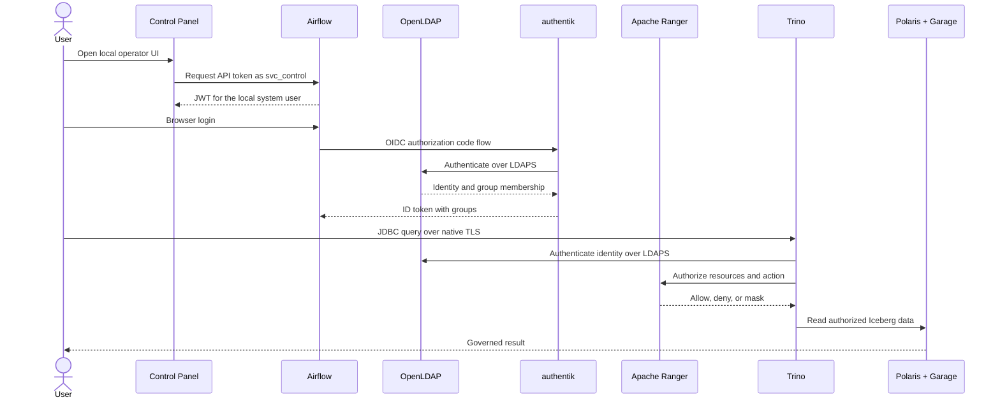

# Security Model

## Identity and Authorization Flow

## Identity

OpenLDAP is authoritative for human users and group membership. authentik is the
OIDC identity provider: it syncs users and the `lakehouse_*` groups from OpenLDAP
through the read-only `svc_authentik` bind account and issues access tokens with
`preferred_username` and `groups` claims. Humans sign in through authentik to
JupyterHub, Airflow, Superset, and the Trino web UI, and Polaris accepts only
authentik tokens. Application metadata databases may cache user records but do
not define independent human passwords.

Machines use dedicated system identities instead of a human account:

| Identity | Used by | Where it is enforced |
| --- | --- | --- |
| `svc_pipeline` (authentik service account, group `lakehouse_pipeline`) | Airflow's Spark job | Polaris principal role `pipeline` (write) |
| `svc_trino` (group `lakehouse_trino`) | Trino's Polaris catalog | Polaris principal role `trino` (read-only) |
| `svc_polaris_admin` (group `lakehouse_service_admin`) | Bootstrap | Polaris `service_admin` |
| `svc_control` (local Airflow user, role Op) | Control panel and `trigger-pipeline.sh` | Airflow |
| `svc_cube` (LDAP account) | Cube to Trino | Trino LDAP password and Ranger |

The authentik service accounts authenticate with the OAuth `client_credentials`
grant on the `lakehouse` provider; the client secret is
`base64("<user>:<app password>")`, which authentik accepts for service accounts.
Airflow's token endpoint accepts only local users when the UI uses OIDC, which is
why `svc_control` is a local user. The control panel keeps only the Airflow JWT in
Streamlit session state.

Accepted exceptions: Ranger Admin and usersync stay on LDAP, Cube reaches Trino
with the `svc_cube` LDAP password because its driver cannot do OAuth2, and the
Spark UI, the loopback control panel, and Garage have no OIDC. Non-human
PostgreSQL roles and Garage access keys are generated into `.env`.

## Policy Model

| Identity | Ranger intent |
| --- | --- |
| `LDAP_ANALYST_USERNAME` / `lakehouse_analysts` | Read curated gold tables with customer email masking |
| `LDAP_ENGINEER_USERNAME` / `lakehouse_engineers` | Read and write lakehouse data |
| `svc_cube` | Read only the gold resources required by Cube |

Ranger UserSync imports LDAP users and groups. Trino's Ranger plugin enforces
catalog, schema, table, column, masking, and query-execution policies.
One-to-one user mappings are used; cross-user impersonation is disabled.
The two managed human usernames and passwords come from `.env`; OpenLDAP
reconciles those entries and their fixed role memberships whenever it starts.

Analysts and engineers also receive read-only access to `system.jdbc`. JDBC
clients such as DBeaver query these metadata tables to discover catalogs,
schemas, types, and tables; this policy exposes metadata only and does not grant
additional lakehouse data access.

## Semantic-Layer Boundary

Superset authenticates users through authentik, but its PostgreSQL-compatible
connection to Cube does not propagate the individual identity to Trino.
Downstream queries therefore run as `svc_cube`, whose Ranger policy is limited
to curated gold data.

## Transport

`./lakehouse.sh init` creates a local CA and certificates for LDAP, Trino, and
the Traefik gateway. Named browser routes use Traefik HTTPS, LDAP uses LDAPS,
and Trino terminates TLS natively for JDBC. The CA at
`platform/config/pki/ca.crt` is intended only for this local environment.

Traefik reads Docker metadata through a read-only socket mount and ignores
unlabeled services.

Direct Airflow, Spark, control-panel, and Trino ports bind to `127.0.0.1`.
Airflow and the control panel therefore use HTTP only across the local loopback
interface; Trino retains native TLS because it accepts LDAP passwords from JDBC
clients. None of these ports is available to other hosts without a tunnel or
an explicit Compose configuration change.

Traefik routing metadata contains no secrets. Labels select routers,
entrypoints, TLS, and internal service ports; certificates remain mounted from
the ignored PKI directory through the file provider.

## Secrets

Secrets live in ignored `.env` and `platform/config/pki` paths. Generated
service-owned configuration and truststores are also ignored.

## Enforcement Boundaries

Polaris and Garage have no supported Ranger enforcement plugin in this design.
They remain internal. Polaris runs in `external` authentication mode: its internal
token endpoint is disabled (HTTP 501), so the shared `root` client credential no
longer works and every caller needs an authentik token whose principal exists in
Polaris. Authentik groups `lakehouse_<role>` map to Polaris principal roles
`<role>`; the platform engines use the machine identities above.
The first bootstrap of a stack runs once in `mixed` mode (see
`auth-mixed.properties`) so `root` can create the machine principals.
Analysts may read only the `gold` namespace; engineers manage all content.
Notebook Spark sessions authenticate to Polaris with the user's token, so
Polaris enforces catalog access per user.

Limits of that enforcement:

- Garage has no STS, so Polaris cannot vend per-user storage credentials. Notebook
  kernels receive the shared Garage keys, and a user who knows them can read
  table files directly.
- Ranger column masks apply only in Trino. A Spark session reads unmasked columns
  in any table its Polaris role may read.
- Trino reaches Polaris with the shared credential, so Ranger alone authorizes
  Trino queries.
- The hub token broker holds the OIDC client secret and every user's refresh token,
  and users are not hub admins so a kernel cannot read another user's token.

Ranger audit events are retained in container logs through Log4j.
