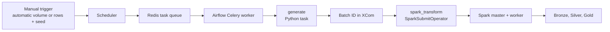

# Orchestration

Apache Airflow owns pipeline control flow while Spark owns data processing.
The DAG never performs analytical transformations inside Airflow tasks.

## Airflow Processes

Airflow 3 separates control-plane processes from task execution:

| Process | Responsibility | Public |
| --- | --- | --- |
| API server | UI, REST API, task execution API | Traefik HTTPS and localhost `8080` |
| Scheduler | Creates task instances and queues them through Celery | No |
| Celery worker | Runs Python tasks and submits Spark applications | No |
| DAG processor | Parses and serializes DAG code | No |

Redis carries queued work, while PostgreSQL stores Airflow metadata and Celery
task results.

Shared non-secret settings are persisted in
`../platform/config/airflow/airflow.cfg` and mounted into every Airflow
container. Secret keys and password-bearing database URLs remain environment
variables sourced from `.env`.

## Retail DAG



The DAG is unscheduled and can be triggered with:

```bash
./lakehouse.sh pipeline
ROWS=5000 SEED=42 ./lakehouse.sh pipeline
```

The [control panel](../control-panel/README.md) provides the same trigger at
`http://127.0.0.1:8501`. Retries are scoped by batch identifier.
