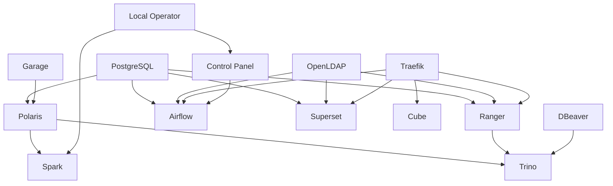

# Platform

This domain contains the container build definitions and runtime configuration
for the lakehouse services.

## Responsibilities

- Build the extended Airflow, OpenLDAP, Polaris, Ranger, Spark, Superset, and control-panel images.
- Configure PostgreSQL, Garage, Trino, Traefik, Ranger, and application authentication.
- Hold generated local PKI beneath `config/pki`; private material is ignored.
- Keep every runtime version pinned and every service health-checkable.

## Layout

```text
images/   Multi-stage Dockerfiles and service entrypoints
config/   Mounted application configuration and Ranger policies
```

## Exposure Policy

| Service | Exposure |
| --- | --- |
| Airflow | Traefik HTTPS and direct `127.0.0.1:8080` |
| Ranger | Traefik HTTPS only |
| Superset | Traefik HTTPS only |
| Cube | Traefik HTTPS only |
| Control panel | Direct `127.0.0.1:8501` only |
| Spark master UI | Direct `127.0.0.1:8081` only |
| Trino | Native TLS on `127.0.0.1:8443` |
| PostgreSQL and OpenLDAP | Direct loopback administrative ports |

Traefik uses the Docker provider with `exposedByDefault: false`. Participating
services define `traefik.enable`, router rule, `websecure` entrypoint, TLS, and
internal load-balancer port labels. Certificates remain in the file provider
rather than Docker labels.

Ranger is built from the verified Apache source release because no suitable
official runtime image is available. Polaris combines the official server and
admin-tool artifacts so relational metadata initialization belongs to the
primary service rather than a one-shot container.

## Service Topology



See the [image inventory](../docs/images.md) and
[architecture guide](../docs/architecture.md) for implementation rationale.
