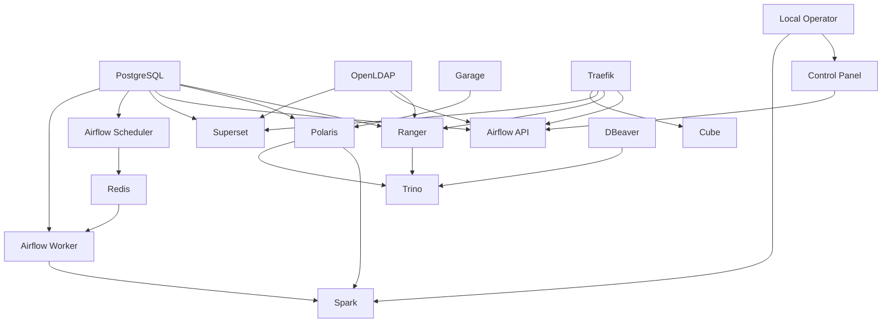

# Platform

This domain contains the container build definitions and runtime configuration
for the lakehouse services.

## Responsibilities

- Build the extended Airflow, OpenLDAP, Polaris, Ranger, Spark, Superset, and control-panel images.
- Configure PostgreSQL, Redis, Garage, Trino, Traefik, Ranger, and application authentication.
- Hold generated local PKI beneath `config/pki`; private material is ignored.
- Keep every runtime version pinned and every service health-checkable.

## Layout

```text
images/   Multi-stage Dockerfiles and service entrypoints
config/   Mounted application configuration and Ranger policies
```

Runtime configuration for Airflow, Spark, Redis, PostgreSQL, Polaris,
Streamlit, Trino, Traefik, and Superset is tracked and mounted read-only. See
the [configuration inventory](config/README.md) for paths and the boundary
between files, environment wiring, and secrets.

## Exposure Policy

| Service | Exposure |
| --- | --- |
| Airflow | Traefik HTTPS and direct `127.0.0.1:8080` |
| Ranger | Traefik HTTPS and direct `127.0.0.1:6080` |
| Superset | Traefik HTTPS only |
| Cube | Traefik HTTPS only |
| Control panel | Direct `127.0.0.1:8501` only |
| Spark master UI | Direct `127.0.0.1:8081` only |
| Trino | Native TLS on `127.0.0.1:8443` |
| PostgreSQL and OpenLDAP | Direct loopback administrative ports |
| Redis | Internal Docker network only |

Traefik uses the Docker provider with `exposedByDefault: false`. Participating
services define `traefik.enable`, router rule, `websecure` entrypoint, TLS, and
internal load-balancer port labels. Certificates remain in the file provider
rather than Docker labels.

## Service Topology



See the [architecture guide](../docs/architecture.md) for deployment topology.
